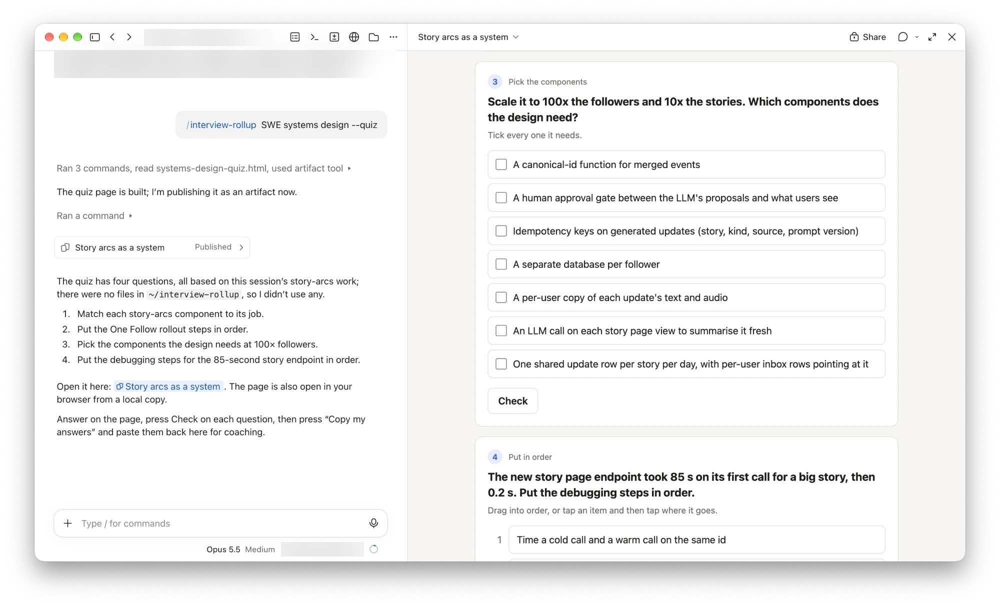
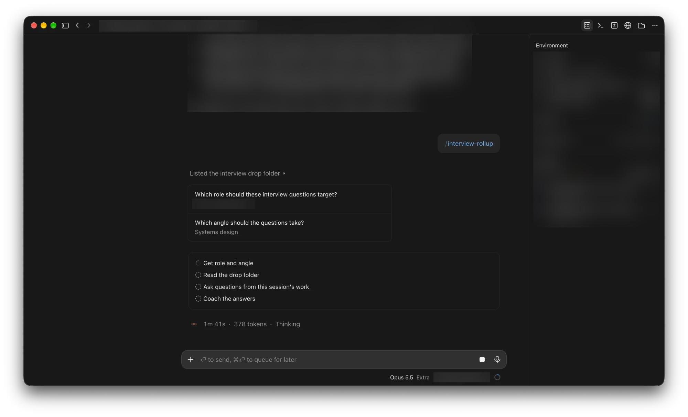

# /interview-rollup

A Claude Code skill for prepping for interviews without leaving what you're building.

Run it at the end of a session and it asks you a few interview questions for the role and the
angle you name, built from the work you just did. Today's permissions table becomes "the
permissions layer of a multi-tenant service: how does it hold at 10x tenants?" Answer them, and
it tells you what landed, what was missing, and gives a tighter version in your own words.

## Install

As a Claude Code plugin:

```
/plugin marketplace add leonimanuel/interview-rollup
/plugin install interview-rollup@interview-rollup
```

With the [skills CLI](https://skills.sh):

```bash
npx skills add leonimanuel/interview-rollup
```

Or by hand: copy `skills/interview-rollup/` into `~/.claude/skills/`.

It's built for Claude Code: it asks through Claude Code's question cards and finds its quiz
builder through `${CLAUDE_SKILL_DIR}`.

## Use

```
/interview-rollup "Senior Platform Engineer" "systems design"
/interview-rollup backend debugging
/interview-rollup "Applied AI Engineer" scaling --quiz
```

- **Default:** up to four multiple-choice question cards in the chat. Pick an option or type
  your own answer.
- **`--quiz`:** a small page that opens in your browser, with drag-to-order, drag-to-match
  and pick-the-components questions. Press Check on each one, then "Copy my answers" and
  paste them back into the session to be coached.

If the session hasn't done any real work yet, the questions come from the role and the angle
alone.

`/interview-rollup SWE systems design --quiz` at the end of a session that built a
story-following feature: four questions grown from that work, as a page.



Run with no arguments, it asks for the role and the angle first.



## Drop folder

Put anything useful in `~/interview-rollup/` (or set `INTERVIEW_ROLLUP_DIR`): job descriptions,
notes on a company or a round, your resume, a story bank. Each run reads the files that fit the
role, plus the ones that aren't tied to any role. It works without the folder.

## Needs

Claude Code. `python3` for `--quiz` (standard library only). See [examples/sample-quiz.json](examples/sample-quiz.json)
for the quiz format; build it yourself with:

```bash
python3 skills/interview-rollup/quiz/build.py examples/sample-quiz.json
```

## License

MIT
